# Nipah Virus Outbreaks 2025–2026 — India & Bangladesh

A complete time-series, epidemiological and machine-learning analysis of the Nipah virus
(NiV) outbreak record for India and Bangladesh (1998–2026), together with the three
laboratory-confirmed 2026 outbreak investigations.

**Deliverables**

| | |
|---|---|
| **Time-series notebook** | [`notebook/nipah_time_series_analysis.ipynb`](notebook/nipah_time_series_analysis.ipynb) — 15 business questions, every code cell followed by a written analysis cell |
| **Machine-learning notebook** | [`notebook/nipah_ml_polynomial_regression.ipynb`](notebook/nipah_ml_polynomial_regression.ipynb) — model development, validation, diagnostics and model card |
| **Dashboard** | [`app/app.py`](app/app.py) — interactive Streamlit dashboard, six tabs |
| **Models** | `models/` — seven polynomial-regression trend models + registry |
| **Figures** | `img/` — 25 publication-quality charts |
| **Tables** | `output/` — exported analytical tables and model-audit files |

---

## The dataset in one paragraph

Nipah virus is a bat-borne zoonotic paramyxovirus on the WHO R&D Blueprint priority
list, with no licensed vaccine and no specific antiviral. Across the India–Bangladesh
belt it kills roughly **three of every four people it infects**, but arrives in small,
sharp, geographically contained bursts. The result is a demanding time-series problem:
a **zero-inflated, spike-dominated count process observed only 29 times** — 413
confirmed cases and 305 deaths, with nine years recording none at all.

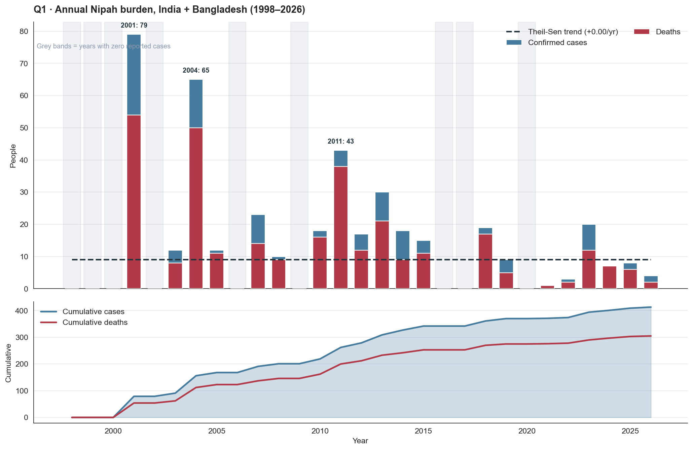

*The whole problem in one chart. Red is deaths, blue the survivors above them — they
track almost perfectly, because roughly three in four cases die. Grey bands mark the
**nine years with zero reported cases**; those years carry no row in the raw file and
are re-inserted as explicit zeros, without which every trend statistic would be computed
on a distorted index. The dashed Theil–Sen trend is flat at **+0.00/yr**.*

---

## Part A — the long-run series (1998–2026)

| # | Question | Headline answer |
|---|---|---|
| Q1 | Is there a long-run trend? | **No monotonic trend** (Mann-Kendall τ = 0.000, p = 1.00). A Poisson GLM's p = 2×10⁻⁹ is an artefact of 26:1 overdispersion. |
| Q2 | How concentrated is the burden? | **Extremely** — Gini 0.627; 2001 alone holds 19.1%; top 3 years hold 45.3%. |
| Q3 | Has lethality improved? | **No.** Pooled CFR 73.8%; 76.3% → 69.5% across halves, p = 0.130. |
| Q4 | India vs Bangladesh? | **Same lethality, different rhythm.** Active 62% vs 31% of years (p = 0.018); CFR gap not significant. |
| Q5 | How often does it return? | **Annually now** — 14 of 19 gaps are 1 year; 6 consecutive active years 2021–2026. |
| Q6 | Does one year predict the next? | **No.** ACF(1) = −0.091, no significant lag, ADF p < 0.0001 (stationary). |
| Q7 | What does smoothing reveal? | **Two waves, not a decline** — peak 33.6/yr (2003) → 6.3/yr (2026); SD fell 2.79×. |
| Q8 | Is there a structural break? | **Probably at 2015**, but Bonferroni p = 0.87. Mean 22.8 → 6.45 cases/yr. |

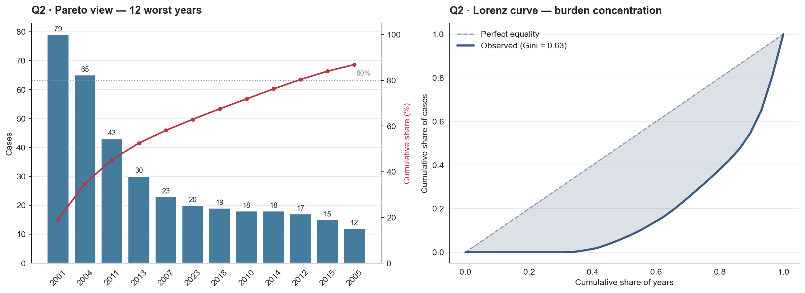

*A Gini coefficient of **0.627** — more unequal than household income in most countries.
**2001 alone holds 19.1%** of all cases in 29 years; the top three hold 45.3%; the 14
quietest years hold 5.6% between them. The two largest years (Siliguri 2001, Faridpur
2004) were both amplified inside hospitals. **This is why surge capacity, not average
throughput, is the binding planning constraint** — a system sized for the 14.2-case mean
is sized for a year that has never happened.*

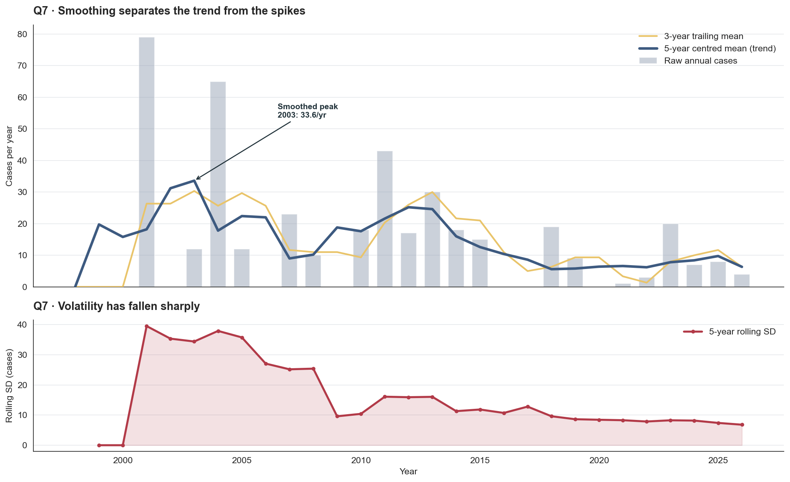

*Smoothing turns an unreadable series into a **two-wave story**: a first peak of
33.6 cases/yr around 2003, a trough near 9 in 2007–09, a second peak of 25.2 in 2012,
then a sustained low of ~6 from 2018. That bimodal shape is exactly why Q1's monotonic
trend test correctly reports nothing. The lower panel carries the finding with the most
operational value: **volatility collapsed from SD 25.80 to 9.25**, and the worst year
fell from 79 cases to 30.*

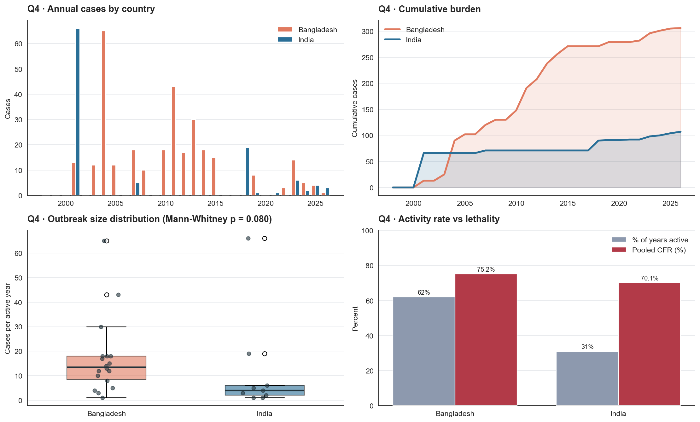

*Two countries, one virus, **two different rhythms**. Bangladesh is active in 18 of 29
years (62%), driven by the December–April raw date-palm sap harvest; India in 9 (31%) —
quiet for years, then a single explosive nosocomial cluster. The frequency gap is
significant (p = 0.018). The **lethality gap is not** (75.2% vs 70.1%, p = 0.304) — so
the intervention points differ even though the outcome does not.*

---

## Part B — the 2026 outbreaks

| # | Question | Headline answer |
|---|---|---|
| Q9 | How fast is detection? | Onset→admission **8.0 d** (immovable); admission→confirmation **1–9 d** (fixable). |
| Q10 | How fast was tracing? | **Excellent** — activation in 0–1 days, full clearance inside the incubation window. |
| Q11 | What capacity is needed? | **~100 contacts/case**; 25–30 samples/day; **no weekend slowdown** (p = 0.87). |
| Q12 | Who was exposed, who got infected? | **331 contacts, 0 positives.** West Bengal 71.4% hospital-linked. |
| Q13 | Did risk stratification drive priority? | **No** (Kruskal-Wallis p = 0.635) — highest-risk contacts sampled *last*. |
| Q14 | Where does it recur, and how? | Four theatres; **Kerala recurring but shrinking**; all three routes appeared in 2026. |

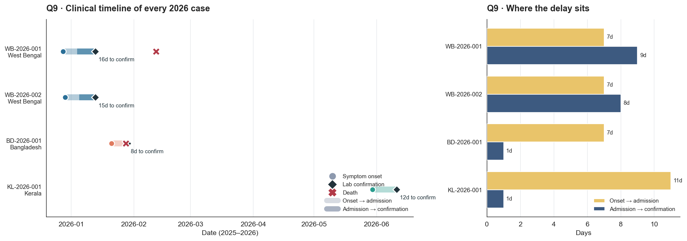

*Every confirmed 2026 case, day by day. **Three of the four patients took exactly 7 days
to reach hospital** — Nipah starts as undifferentiated fever, and no laboratory
investment shortens that week. The *controllable* interval is admission → confirmation,
and it varies fivefold: Bangladesh and Kerala confirmed in **1 day**, West Bengal took
**8 and 9**. Note `BD-2026-001`, whose lab confirmation arrived the day **after** the
patient died.*

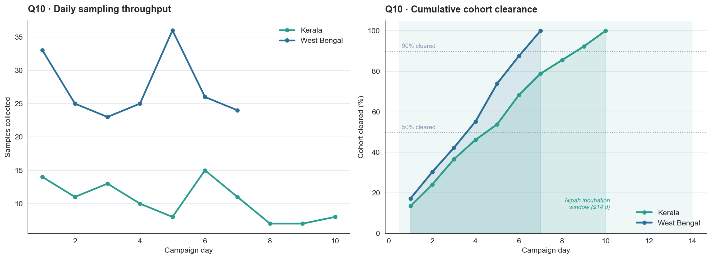

*Both Indian campaigns cleared their **entire** contact cohort inside the 4–14 day
incubation window, with **zero idle days** and activation 0–1 days after confirmation.
West Bengal's steeper curve is not better work: a nosocomial cluster hands investigators
a pre-enumerated cohort from duty rosters, while Kerala had to *discover* contacts
through community investigation.*

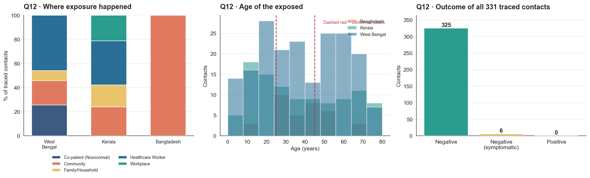

*The headline surveillance result of the whole project: **331 traced contacts, zero
positives.** Every 2026 case was a terminal node. Six Bangladeshi contacts developed
symptoms and were correctly cleared. The exposure mix differs sharply between outbreaks
(χ² = 74.6, p < 0.0001), exactly as the transmission routes predict — **71.4% of West
Bengal's contacts were hospital-linked**, Bangladesh's were 100% community.*

---

## Part C — the machine-learning component

Two artefacts: **`src/train_models.py`** (the shipped training code) and
**`notebook/nipah_ml_polynomial_regression.ipynb`** (the full model-development
notebook — 51 cells, 16 code / 35 analysis).

For each target the search covers **degree (1–6) × ridge penalty × variance-stabilising
transform** (identity / log1p / sqrt), selected by **leave-one-out cross-validation** and
always scored back on the **original scale**. Every model is compared against a
*predict-the-mean* baseline put through the **same** LOO split.

| Target | Transform | Degree | CV R² | CV RMSE | Baseline | Beats mean? |
|---|---|---|---|---|---|---|
| `cases_trend_ma5` | identity | 6 | **+0.546** | 5.53 | 8.49 | Yes |
| `cases_outbreak_years` | log1p | 5 | **+0.304** | 16.42 | 20.72 | Yes |
| `cases_bangladesh` | identity | 5 | +0.042 | 14.19 | 15.02 | Yes |
| `cases_india` | log1p | 5 | −0.075 | 12.791 | 12.778 | Dead heat |
| `deaths_total` | identity | 3 | −0.077 | 14.56 | 14.53 | No |
| `cases_total` | identity | 3 | −0.087 | 19.74 | 19.61 | No |
| `cfr_outbreak_years` | identity | 1 | −0.189 | 16.57 | 15.99 | No |

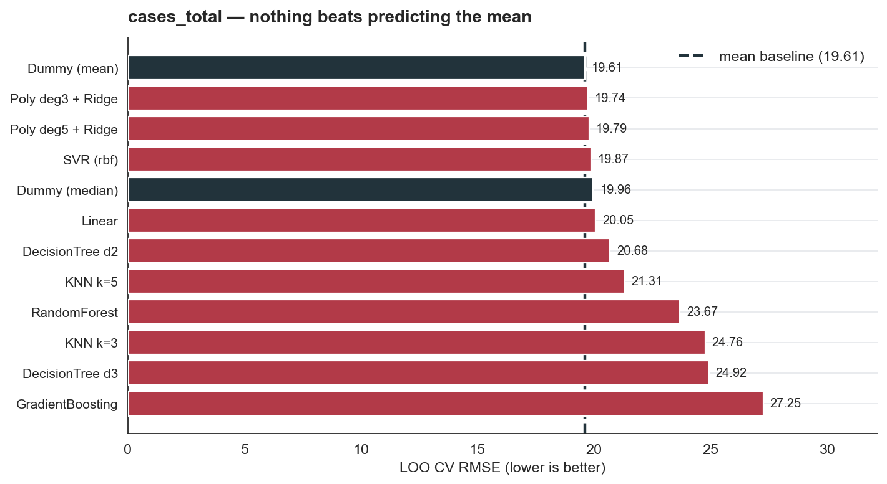

*Twelve model families benchmarked, and **the baseline finishes first.** Not one learner
beats simply predicting 14.24 cases every year. The ensembles are the *worst* performers
— Gradient Boosting scores R² = −1.072, more than double the mean's squared error —
because with 29 points and one feature their capacity is spent entirely on memorising
noise.*

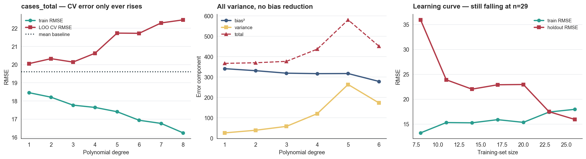

*There is **no bias–variance U-curve**: validation error rises from degree 1 onward, so
overfitting begins immediately. The middle panel shows why — **bias² barely moves
(341 → 317, a 7% reduction) while variance explodes tenfold (26 → 263)**. You pay the
variance and receive nothing. The right panel carries the one hopeful result: the
learning curve is **still falling at n = 29**, so the ceiling here is sample size, not
model class.*

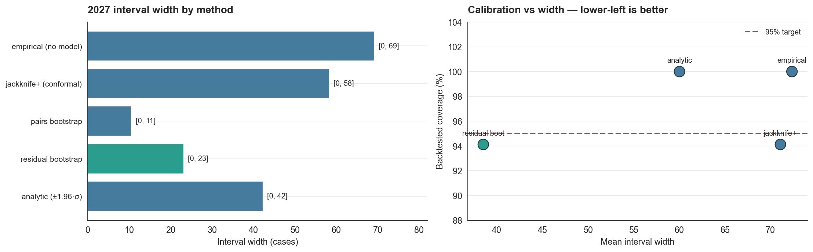

*The analytic `±1.96·σ` interval is not wrong so much as **wasteful**: it over-covers at
100% against a 95% target, at a mean width of 60.0. The **residual bootstrap** hits
**94.1% coverage at width 38.5** — properly calibrated and 36% narrower — because it
resamples the actual residuals instead of assuming a normality that Shapiro–Wilk rejects
(p = 0.0002). This finding changed the production code.*

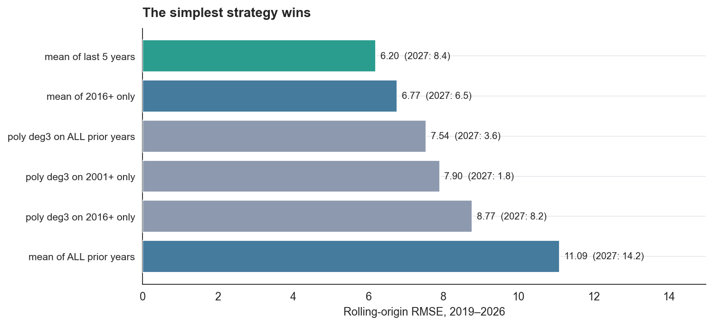

*The most decision-relevant chart in the project, and an uncomfortable one for a notebook
about polynomial regression: **a five-year rolling mean beats every polynomial tested**
(RMSE 6.20 vs 7.54). Restricting the polynomial to the post-2015 regime makes it *worse*,
not better (8.77) — removing bias adds more variance than it removes at n ≈ 11. Note too
that the 2027 predictions span **1.8 to 14.2** across strategies fitted to the same 29
points.*

### What the ML notebook establishes

| Finding | Evidence |
|---|---|
| Annual counts are **not predictable from calendar time** | CV R² = −0.087; 4 of 7 models lose to a constant |
| **Lasso reached the same conclusion independently** | Zeroed its only coefficient → RMSE 19.61, exactly the mean |
| **No rival learner does better** | 12 families benchmarked; baseline finished first; GBM scored R² = −1.072 |
| **Even the "winning" models aren't significant** | Best gap's 95% CI is [−15.28, +2.98] |
| **The Poisson p-value was an artefact** | Poisson p = 2.4×10⁻⁹ → Negative Binomial p = **0.2054**; ΔAIC = 464 |
| **log1p repairs the normality assumption** | Shapiro–Wilk p: 0.0006 → **0.883** |
| **Bootstrap intervals beat analytic ones** | Backtested 94.1% coverage at width 38.5, vs 100% at 60.0 |
| **Overfitting begins at degree 1** | Variance ×10 (26 → 263) while bias² falls only 7% |
| **Two points dominate the fit** | Cook's D: 2001 = 0.386, 2004 = 0.162 (threshold 0.138) |
| **A 5-year rolling mean beats every polynomial** | Rolling-origin backtest RMSE 6.20 vs 7.54 |
| **The ceiling is sample size, not model class** | Learning curve still falling at n = 29 |

**Four of seven models are reported as failures rather than hidden.** For a pathogen with
a ~74% case fatality ratio, a defensible "this cannot be forecast, and here is the
evidence" is worth more than a confident number. The recommended 2027 planning figure
comes from a five-year rolling mean (~8.4 cases), **not** from these models.

### Two bugs the ML notebook found in this project's own code

1. **An unfair baseline** — cross-validated model error was being compared against
   *in-sample* baseline error. Fixing it changed `cases_india` from a clear loss to a
   dead heat.
2. **A mis-specified prediction interval** — the analytic `±1.96·σ` assumed normal
   residuals that Shapiro–Wilk rejects, over-covered at 100%, and produced a CFR upper
   bound of **104.61%**. Replaced with a residual bootstrap, which returns [64.2, 83.8]
   with no constraint added.

Both fixes ship in `src/train_models.py`.

---

## Interactive dashboard

```bash
streamlit run app/app.py
```

Six tabs — Overview, Time-series diagnostics, Country comparison, 2026 outbreaks,
Polynomial model, Data & exports — with 21 interactive Plotly charts, year-range and
country filters, an adjustable smoothing window, and a model explorer that inspects any
of the seven fitted models with its degree-selection curve and residual plot.

The dashboard imports the same `src/nipah_data.py` the notebooks use, so **every number
it shows matches the notebooks by construction.**

## Project layout

```
input/     six raw CSVs (Kaggle dataset)
doc/       dataset documentation
src/       nipah_data.py    — shared loaders, cleaning, feature engineering
           train_models.py  — polynomial regression models
notebook/  nipah_time_series_analysis.ipynb      — 15 business questions
           nipah_ml_polynomial_regression.ipynb  — ML model development
app/       app.py — Streamlit dashboard
models/    seven .joblib models + model_registry.json
output/    exported analytical tables + model audit files
img/       25 figures
```

## Setup

The original project path is deep and sits under OneDrive, which pushes `site-packages`
past the Windows 260-character limit and breaks scikit-learn's DLL loading. **Create the
virtual environment at a short path instead:**

```bash
python -m venv C:\venvs\nipah
C:\venvs\nipah\Scripts\python.exe -m pip install -r requirements.txt
```

## Run

Train the models:

```bash
C:\venvs\nipah\Scripts\python.exe src/train_models.py
```

Execute the time-series notebook:

```bash
C:\venvs\nipah\Scripts\python.exe -m jupyter nbconvert --to notebook --execute --inplace notebook/nipah_time_series_analysis.ipynb
```

Execute the machine-learning notebook:

```bash
C:\venvs\nipah\Scripts\python.exe -m jupyter nbconvert --to notebook --execute --inplace notebook/nipah_ml_polynomial_regression.ipynb
```

Launch the dashboard:

```bash
C:\venvs\nipah\Scripts\streamlit.exe run app/app.py
```

> **Windows note.** If notebook execution fails with `Bad file descriptor (…epoll.cpp)`,
> Anaconda's `libzmq.dll` is shadowing the virtual environment's copy. Run the command
> with `PATH` limited to `C:\venvs\nipah\Scripts` plus the Windows system directories.

## Key limitations

Stated plainly, because they bound every conclusion above:

- **n = 29 annual observations.** Most tests in Part A are underpowered; several large
  effects (the 2015 break, the volatility drop) fail to reach significance despite
  substantial effect sizes. Absence of significance is not evidence of absence.
- **No month field on historical outbreaks.** Seasonality — the best-established feature
  of Nipah epidemiology — cannot be tested directly. Only four 2026 onset months exist.
  **This is the highest-value addition that could be made to the dataset.**
- **No denominators.** Incidence rates cannot be computed and countries cannot be
  compared per capita.
- **Detection is confounded with incidence throughout.** Kerala's rising event count and
  falling case counts are consistent with better detection, better control, or both.
- **Bangladesh contact records carry no sampling dates**, so that outbreak cannot enter
  any daily surveillance analysis.

---

Source data: WHO Disease Outbreak News, CDC and peer-reviewed outbreak reports.
